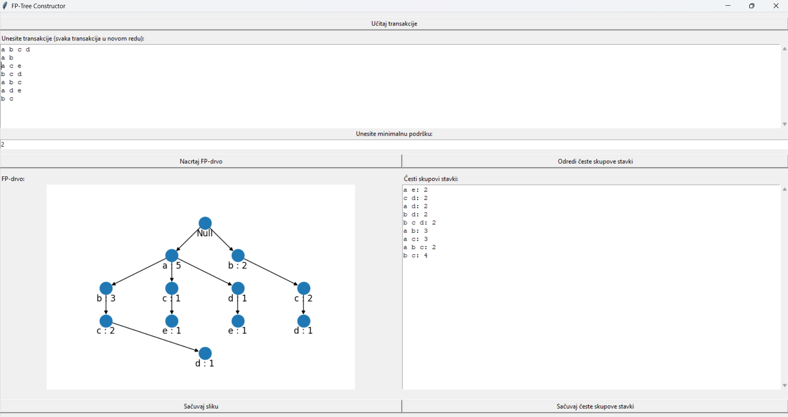

# FP-Growth Visualizer

Desktop tool for frequent pattern mining with the FP-Growth algorithm. It builds and visualizes the FP-tree for a set of transactions and lists frequent itemsets for a given minimum support.

Course project for Data Mining 2, Faculty of Mathematics, University of Belgrade.



## Features

- Load transactions from a file or type them in directly (one transaction per line, items separated by spaces)
- **FP-tree construction implemented from scratch:** node structure, header table with node-link chains, items ordered by descending support
- Tree visualization (level-by-level layout with item counts), export as PNG
- Frequent itemset mining for a given minimum support (via pyfpgrowth), export as TXT
- Input validation with error messages (missing transactions, invalid minimum support)

## Tech stack

Python, Tkinter (GUI), NetworkX + Matplotlib (tree visualization), pyfpgrowth (frequent itemset mining). The FP-tree itself is built without external libraries.

## Quick start

```bash
pip install pyfpgrowth networkx matplotlib
python FP-drvo.py
```

1. Load or enter transactions and click **"Nacrtaj FP-drvo"** to draw the tree
2. Enter a minimum support (positive integer) and click **"Odredi česte skupove stavki"** to list frequent itemsets
3. Save the tree image or the itemsets with the save buttons

The GUI labels are in Serbian. Full Serbian documentation: [README_sr.md](README_sr.md)
